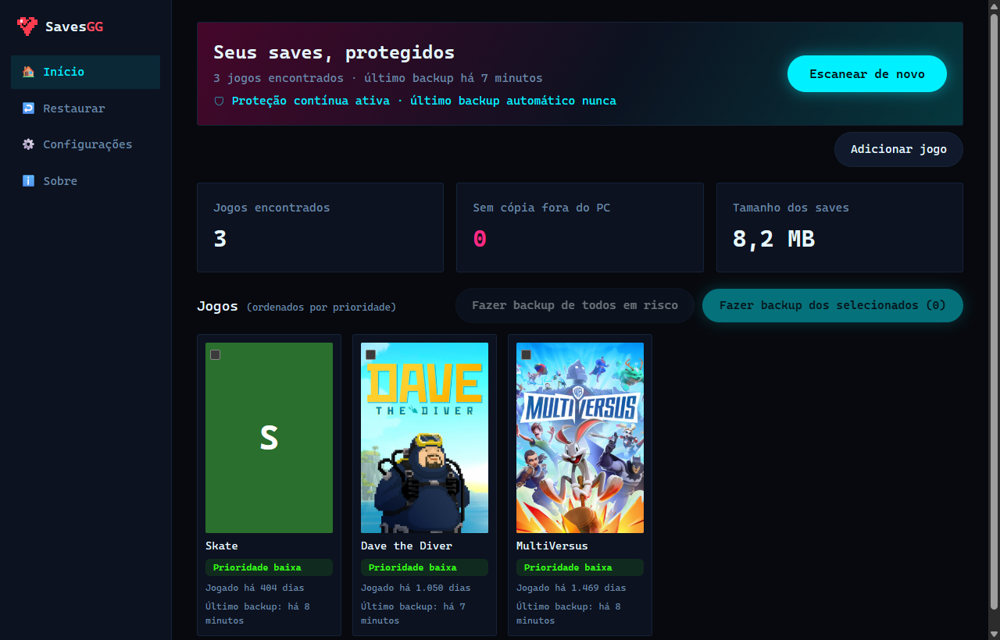
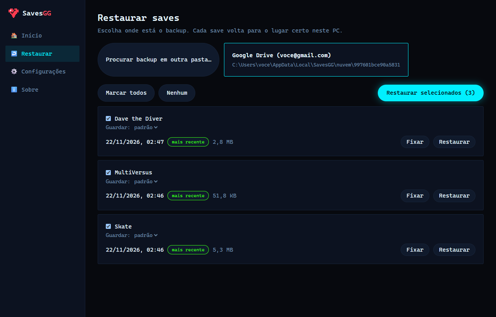
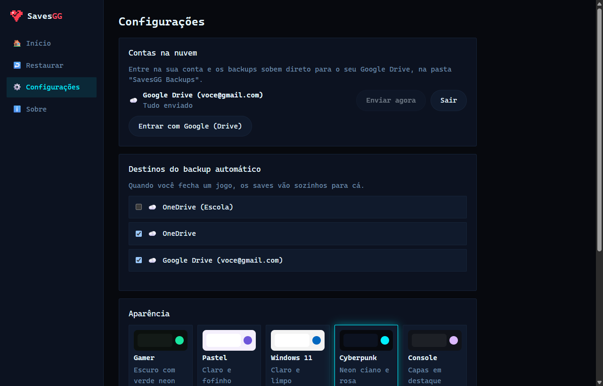
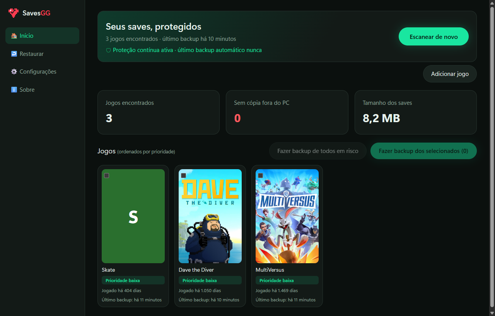
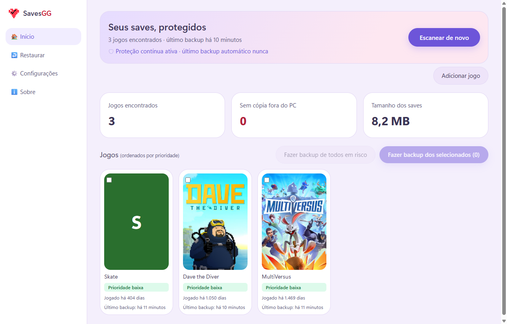
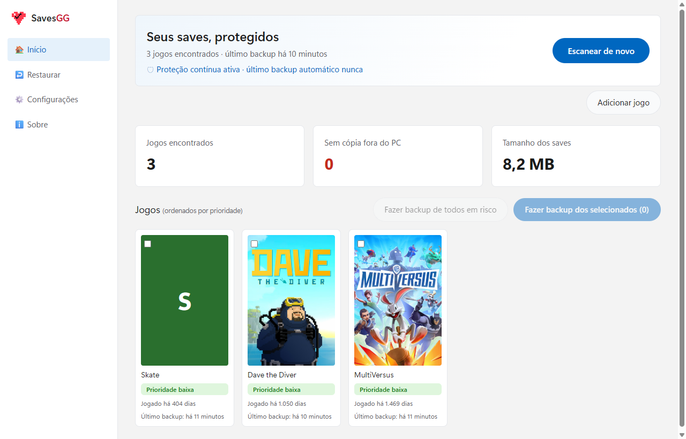
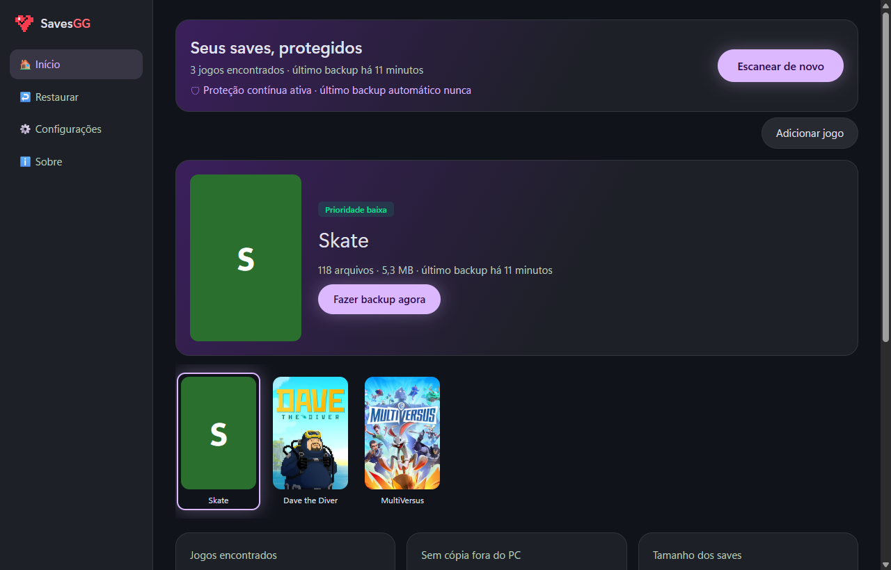

# SavesGG

App para Windows que encontra os saves de todos os seus jogos (Steam, Epic, GOG, Xbox, emuladores e jogos sem loja), mostra quais correm risco por não terem cópia fora do PC e faz backup contínuo para nuvem (pasta do OneDrive/Google Drive/Dropbox), pendrive ou HD externo, com versões e restauração num PC novo.

## Baixar

- **Instalador (recomendado):** [SavesGG_x64-setup.exe](https://github.com/thelipesousa/savesgg/releases/latest/download/SavesGG_x64-setup.exe), que inicia com o Windows e se atualiza sozinho.
- **Portable (pendrive, sem instalar):** [SavesGG_portable_x64.zip](https://github.com/thelipesousa/savesgg/releases/latest/download/SavesGG_portable_x64.zip).
- Todas as versões: [Releases](https://github.com/thelipesousa/savesgg/releases). Windows 10/11 64 bits.

Feito com **Tauri 2 + Rust** (motor) e **Svelte + TypeScript + Tailwind** (interface).

- Design aprovado: [`docs/superpowers/specs/2026-11-20-saveguard-design.md`](docs/superpowers/specs/2026-11-20-saveguard-design.md)
- Referências visuais (Google Stitch): [`design/stitch/`](design/stitch/)



## Telas

| Restaurar | Contas na nuvem e destinos |
|---|---|
|  |  |

**Os 5 temas** (trocados na hora em Configurações → Aparência):

| Gamer | Pastel | Windows 11 |
|---|---|---|
|  |  |  |

| Cyberpunk | Console |
|---|---|
|  |  |

## Como funciona

### 1. Achar os saves

O app traz embutido o [manifesto do Ludusavi](https://github.com/mtkennerly/ludusavi-manifest), uma lista com onde cada jogo guarda o save (dados da PCGamingWiki). Ao escanear, ele descobre os jogos instalados (Steam, Epic, GOG, Xbox, emuladores), confere quais caminhos da lista existem neste PC e calcula a prioridade de cada jogo: tamanho, quando foi jogado e se já tem cópia fora do PC. Jogos que a lista não conhece podem ser adicionados à mão.

### 2. Cada backup é uma versão com dois arquivos

```
SavesGG/
└── dave-the-diver/
    ├── 2026-11-22_02-47-14.zip    ← os arquivos do save, compactados
    └── 2026-11-22_02-47-14.json   ← a "etiqueta": de onde veio cada arquivo
```

O `.json` guarda o jogo, a loja, a data, o PC de origem e, para cada arquivo, o **caminho original com marcadores**, o lugar dele dentro do zip, o tamanho e um código de conferência (hash):

```json
{
  "game_name": "Dave the Diver",
  "files": [{
    "template": "<winLocalAppDataLow>/nexon/DAVE THE DIVER/SteamSData/6144/GameSave_00_GD.sav",
    "zip_path": "winLocalAppDataLow/nexon/DAVE THE DIVER/SteamSData/6144/GameSave_00_GD.sav",
    "size": 245599,
    "blake3": "67d6d95a…"
  }]
}
```

Se nada mudou desde a última versão, o app não cria outra. As versões antigas saem sozinhas: por padrão ficam as últimas, e as **fixadas** nunca são apagadas.

### 3. Por que marcadores em vez do caminho completo

No PC de hoje, o save está em `C:\Users\Ana\AppData\LocalLow\...`. Depois de formatar, ou num PC novo, o nome de usuário e até o disco podem ser outros. Por isso o `.json` guarda `<winLocalAppDataLow>`, e não o caminho completo. Os principais marcadores:

| Marcador | Vira, no PC onde se restaura |
|---|---|
| `<home>` | a pasta do usuário (`C:\Users\<você>`) |
| `<winAppData>` / `<winLocalAppData>` / `<winLocalAppDataLow>` | `AppData\Roaming`, `AppData\Local` e `AppData\LocalLow` |
| `<winDocuments>` | a pasta Documentos (mesmo se ela estiver no OneDrive) |
| `<root>` / `<base>` | a pasta da loja e a pasta de instalação do jogo |
| `<storeUserId>` | o id da sua conta na loja (por exemplo, o da Steam) |

### 4. Restaurar devolve cada arquivo ao lugar certo

1. O app lê o `.json` e troca cada marcador pelo caminho **deste** PC, recriando as pastas com os nomes certos.
2. Se o backup estiver no Google Drive, ele baixa o `.zip` na hora.
3. Antes de sobrescrever, guarda os saves atuais numa **versão de segurança** (fixada), para dar para desfazer.
4. Extrai cada arquivo no lugar dele e confere o hash.

Quando não dá para descobrir o caminho sozinho (por exemplo, o jogo ainda não está instalado ou a conta da loja é outra), o jogo aparece em "precisa de você" e você escolhe a pasta.

### 5. Para onde vão os backups

- **Pasta de nuvem sincronizada, pendrive ou HD:** a pasta `SavesGG` é gravada direto no destino (por exemplo, `OneDrive\SavesGG Backups\SavesGG`).
- **Google Drive pelo login do app:** o backup é gravado numa pasta local de preparação e sobe em segundo plano para a pasta **"SavesGG Backups"** do Drive da pessoa, com a mesma estrutura acima. Depois que a versão está inteira na nuvem, o `.zip` local sai para não ocupar espaço. Num PC novo, basta entrar com a mesma conta: a tela Restaurar lista o que está no Drive e baixa só o que for restaurar.

## Como rodar

Requisitos: Windows 10/11, [Rust](https://rustup.rs) estável, Node 22 e o WebView2 (já vem no Windows).

```powershell
npm install
./scripts/atualizar-manifesto.ps1   # baixa o manifesto de saves embutido no app
npm run tauri dev                   # abre o app em modo de desenvolvimento
```

Testes: `cargo test --workspace` (motor e comandos) e `npm run test -- --run` (interface).
Testes com os dados reais do seu PC (não alteram os saves): veja os comandos `--ignored` nos arquivos
`crates/core/src/scan.rs` e `crates/core/tests/ponta_a_ponta_real.rs`.

## Backup automático

- **Quando copia:** 10 s depois de você fechar o jogo (mesmo se ele travar) ou, para jogos sem executável conhecido, 2 min depois de a pasta do save parar de mudar. Com o jogo aberto, nada é copiado: a cópia espera o fechamento para não pesar e não pegar arquivo pela metade.
- **Para onde:** os destinos marcados em **Configurações → Destinos do backup automático**. O backup manual ("Fazer backup dos selecionados") continua perguntando o destino toda vez.
- **Destino fora do ar** (pendrive desplugado, pasta da nuvem sumida): o backup fica na fila em `%LOCALAPPDATA%\SavesGG\pendentes` e é enviado sozinho quando o destino volta.
- **Bandeja:** fechar a janela deixa o SavesGG na bandeja. O ícone mostra o estado (o coração da logo com um ponto: verde protegido, amarelo com jogo sem cópia fora do PC, azul copiando, cinza pausado) e o menu tem backup agora, pausar/retomar, copiar tudo para um disco plugado e sair.
- **Pendrive/HD:** ao plugar, aparece uma notificação e um aviso no Início para copiar tudo (ou atualizar o backup que já está nele).
- **Iniciar com o Windows:** ligado por padrão, abrindo minimizado na bandeja. Desligue em **Configurações → Iniciar com o Windows**. Só vale no app instalado (em desenvolvimento não é registrado).
- **Possíveis saves** (heurística) e jogos acima de 2 GB só entram no automático depois de confirmados.

## Temas e assistente

- **Assistente da primeira execução:** ao abrir pela primeira vez, o SavesGG escaneia o PC, mostra quantos jogos já estão protegidos e quantos não têm cópia fora do PC, pergunta para onde mandar os saves (destinos do backup automático) e deixa escolher o tema. Dá para pular; ele não volta depois de concluído.
- **5 temas**, trocados na hora em **Configurações → Aparência**: Gamer (escuro verde-neon), Pastel (claro e fofinho), Windows 11 (claro e limpo), Cyberpunk (neon ciano e rosa) e Console (jogo em destaque e carrossel de capas, navegável pelas setas).
- **Lista ou grade de capas** para os jogos, também em Aparência.
- **Capas:** vêm da Steam pelo AppID do jogo (`cdn.cloudflare.steamstatic.com`). Sem internet ou sem capa, aparece um cartão com a inicial do jogo. As referências visuais (Google Stitch) e capturas reais ficam em `design/`.

## Restaurar, versões e jogos à mão

- **Restaurar vários jogos de uma vez:** na tela Restaurar, escolha o destino, deixe marcados os jogos e clique em "Restaurar selecionados". Cada jogo volta na versão mais recente que não seja de segurança; antes de substituir um save, o app guarda o atual numa **versão de segurança** (fixada, com selo próprio). Jogos com arquivo sem lugar neste PC aparecem em "precisa de você" para escolher a pasta.
- **Backup em outra pasta:** "Procurar backup em outra pasta…" aceita a pasta que contém `SavesGG`, a própria `SavesGG` ou a raiz da nuvem com `SavesGG Backups`. Vale só até fechar o app (não vira destino automático).
- **Versões:** fixe ou desafixe cada versão (fixadas nunca são apagadas). Quantas guardar: no geral em Configurações e por jogo na tela Restaurar (de 1 a 100).
- **Jogo à mão:** "Adicionar jogo" no Início (nome, pasta do save e, se quiser, o .exe). "Remover" tira da lista e mantém os backups. Possíveis saves descartados podem voltar em Configurações.
- **Aviso da nuvem:** se o OneDrive/Google Drive/Dropbox estiver fechado, o app avisa que os backups não estão subindo.
- **Log:** `%LOCALAPPDATA%\com.savesgg.app\logs\savesgg.log` (botão "Abrir pasta de logs" em Sobre).

## Atualização automática e lançamentos

O app instalado procura versão nova 30 s depois de abrir e a cada 6 h (também em Sobre → "Procurar atualização"). As versões ficam nos [Releases deste repositório](https://github.com/thelipesousa/savesgg/releases). Até a 0.3.1 o app procurava em `thelipesousa/savesgg-releases`; por isso cada lançamento também deixa lá um `latest.json` apontando para cá, para quem ainda tem essas versões se atualizar. Toda atualização é **assinada**: o app recusa arquivo sem assinatura válida.

**Chave de assinatura:** `%USERPROFILE%\.tauri\savesgg.key` (fora do repositório; `*.key` está no `.gitignore`). **Guarde uma cópia em lugar seguro** (ex.: gerenciador de senhas): sem ela não há como publicar atualizações para quem já instalou. A chave pública está em `src-tauri/tauri.conf.json`.

**Lançar uma versão** (na `main`, depois do PR `dev` → `main`):

```powershell
powershell -File scripts/lancar.ps1 -Notas "O que mudou nesta versão"
```

O script compila, assina, gera `latest.json` e `SHA256SUMS.txt` e publica a release `vX.Y.Z` neste repositório, com o instalador em nome estável (`SavesGG_x64-setup.exe`) e o zip portable (`SavesGG_portable_x64.zip`). Para testar sem publicar: `-Ensaio`. Antes, suba a versão em `tauri.conf.json`, `Cargo.toml` (workspace), `src-tauri/Cargo.toml` e `package.json`.

## Versão portable (pendrive)

Cada lançamento traz também `SavesGG_portable_x64.zip`. Descompacte no pendrive e abra o `SavesGG.exe`: nada é instalado.

- **Onde ficam os dados:** se existe a pasta `dados` ao lado do `SavesGG.exe`, o app guarda ali a configuração, a fila de pendentes, a preparação da nuvem e os logs. Sem ela, usa as pastas do Windows, como o instalado. Fica no PC só o cache da tela do WebView2.
- **Bandeja e backup automático:** funcionam igual enquanto o app estiver aberto.
- **Iniciar com o Windows:** fica escondido e o portable não mexe nele (a letra do pendrive muda de PC para PC, e o registro pode ser do SavesGG instalado).
- **Atualização:** o app avisa da versão nova e abre a página de downloads; troque o `SavesGG.exe` pelo novo (a pasta `dados` fica).
- **Login do Google:** fica no Gerenciador de Credenciais de cada PC, nunca no pendrive. Perder o pendrive não entrega a sua conta; em outro PC, entre de novo.
- Precisa do WebView2, que já vem no Windows 10 e 11.
- Se o SavesGG instalado já estiver aberto na bandeja deste PC, abrir o portable só traz a janela do instalado (é um app só por vez). Feche o instalado pela bandeja antes.

## Login no Google Drive

Na seção "Contas na nuvem" de Configurações (e no assistente), cada pessoa entra na própria conta do Google. Os backups vão para a pasta **"SavesGG Backups"** no Drive dela, e o app só enxerga os arquivos que ele mesmo criou (escopo `drive.file`). O login acontece no navegador, com PKCE. O token de acesso contínuo fica no Gerenciador de Credenciais do Windows, nunca em arquivo. Depois de formatar, basta entrar de novo: as versões que estão no Drive aparecem na tela Restaurar.

O backup é gravado primeiro numa pasta local (`%LOCALAPPDATA%\SavesGG\nuvem\...`) e sobe em segundo plano. Sem internet, ele espera e envia depois. O OneDrive entra numa próxima etapa (issue #27).

**Cadastro do app no Google** (feito uma vez, por quem publica o SavesGG):

1. Em <https://console.cloud.google.com>, crie um projeto (por exemplo, "SavesGG") e ative a **Google Drive API**.
2. Em "Tela de consentimento OAuth": tipo **Externo**, nome **SavesGG**, logo opcional, **e-mail de suporte e de contato separados do pessoal** (eles aparecem para quem faz login), página inicial `https://savesgg-site.vercel.app` e política de privacidade `https://savesgg-site.vercel.app/privacidade`. Escopos: `.../auth/drive.file`, `openid` e `email`.
3. **Publique o app ("Em produção").** Em "teste", o login expira a cada 7 dias e só aceita 100 contas listadas à mão.
4. Em "Credenciais", crie um **ID do cliente OAuth** do tipo **App para computador** e copie o ID e a chave secreta. Para apps de desktop, o próprio Google diz que essa chave não é confidencial, mas mesmo assim ela fica fora do Git.
5. Crie `%USERPROFILE%\.tauri\savesgg-oauth.json` com o conteúdo abaixo. O `scripts/lancar.ps1` lê esse arquivo e embute os ids no build. Sem ele, o login aparece como "indisponível nesta versão".

```json
{ "google_client_id": "....apps.googleusercontent.com", "google_client_secret": "..." }
```

Para testar em desenvolvimento, defina as variáveis `SAVESGG_GOOGLE_CLIENT_ID` e `SAVESGG_GOOGLE_CLIENT_SECRET` antes de `npm run tauri dev`.

## Fluxo de branches

- `main`: produção e branch padrão; só código estável, é dela que sai o release.
- `dev`: desenvolvimento e integração; recebe as funcionalidades prontas.
- `feature/<nome>`: uma funcionalidade por branch, criada a partir da `dev`.
- `fix/<nome>`: correção de bug, a partir da `dev`.
- `hotfix/<nome>`: correção urgente em produção, a partir da `main`; depois volta pra `main` e pra `dev`.

Commits no padrão [Conventional Commits](https://www.conventionalcommits.org/pt-br/) (`feat`, `fix`, `docs`…), em português. PRs vão para a `dev`; lançamento é PR `dev` → `main`.

## Créditos

Locais de saves baseados no [ludusavi-manifest](https://github.com/mtkennerly/ludusavi-manifest) (dados da PCGamingWiki).
